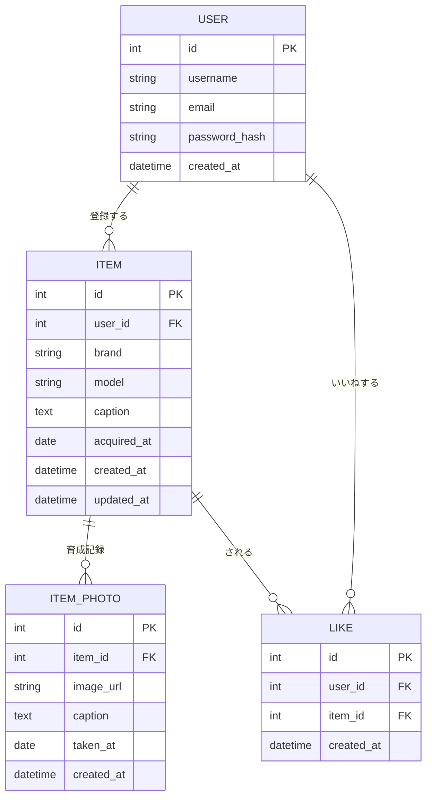
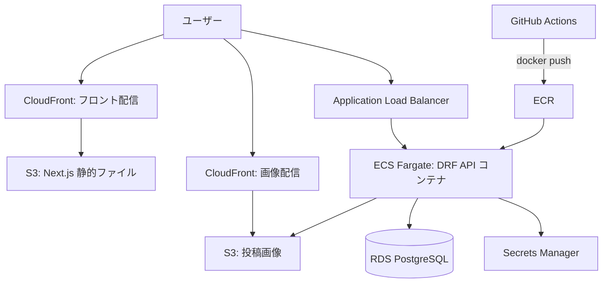

# Patina Gallery — アプリケーション仕様書

## 1. プロジェクト概要

### 1.1 目的

ブーツなど革製品の経年変化(パティーナ)を記録・共有するWebアプリケーション。
「Patina Project」(<https://www.patinaproject.com/>)の日本版を志向し、
1枚ごとにバラバラな画像投稿ではなく、**アイテム(1足のモノ)を中心に、同一アイテムの写真を時系列で蓄積して“育成記録”を残す**点を核とする。
本プロジェクトは **バックエンドエンジニアへの転職ポートフォリオ** を主目的とし、
Django REST Framework による堅牢なAPI設計(アイテムと時系列写真の1対多モデリング・集計)と、AWS上での本番運用構成を重点的にアピールする。

### 1.2 ターゲットユーザー

- レザーブーツ愛好家(RED WING, White's, Whiteなどのファン)
- 自分のブーツの経年変化を記録・共有したい人

### 1.3 ポートフォリオとしての訴求ポイント

| 優先度 | 領域           | アピール内容                                                                                              |
| ------ | -------------- | --------------------------------------------------------------------------------------------------------- |
| 最優先 | バックエンド   | DRFによるRESTful API設計、JWT認証、N+1対策、ページネーション、テスト、S3署名付きURLによる画像アップロード |
| 次点   | インフラ(AWS)  | ECS Fargate / RDS / S3+CloudFront によるコンテナ本番構成、IaC、CI/CD                                      |
| 補助   | フロントエンド | Next.js + shadcn/ui による最小限で破綻しないUI(デザインコストを外部化)                                    |

---

## 2. 技術スタック

### 2.1 バックエンド(重点領域)

| 項目           | 採用技術                                           |
| -------------- | -------------------------------------------------- |
| 言語           | Python 3.12                                        |
| フレームワーク | Django 5.x / Django REST Framework                 |
| 認証           | JWT(`djangorestframework-simplejwt`)               |
| DB             | PostgreSQL 16                                      |
| 画像処理       | Pillow                                             |
| ストレージ連携 | boto3(S3署名付きURL発行)                           |
| API仕様書      | drf-spectacular(OpenAPI 3.0 / Swagger UI 自動生成) |
| テスト         | pytest / pytest-django / factory_boy               |
| Lint/Format    | ruff / black / mypy                                |

### 2.2 フロントエンド

| 項目             | 採用技術                                        |
| ---------------- | ----------------------------------------------- |
| フレームワーク   | Next.js 15(App Router)                          |
| 言語             | TypeScript                                      |
| スタイリング     | Tailwind CSS                                    |
| UIコンポーネント | shadcn/ui(コピペ型部品でデザイン意思決定を削減) |
| 画像ギャラリー   | react-photo-album(Masonryレイアウトを自動計算)  |
| サーバー状態管理 | TanStack Query(React Query)                     |
| フォーム         | React Hook Form + Zod                           |

### 2.3 インフラ(AWS・次点重点領域)

| 項目                 | 採用技術                                  |
| -------------------- | ----------------------------------------- |
| バックエンド実行環境 | ECS Fargate(Dockerコンテナ)               |
| フロントエンド配信   | S3 + CloudFront(静的エクスポート)※        |
| データベース         | RDS for PostgreSQL                        |
| 画像ストレージ       | S3 + CloudFront                           |
| コンテナレジストリ   | ECR                                       |
| ロードバランサ       | Application Load Balancer(ALB)            |
| DNS/証明書           | Route 53 / ACM                            |
| シークレット管理     | AWS Secrets Manager / SSM Parameter Store |
| CI/CD                | GitHub Actions                            |
| IaC(任意)            | Terraform または AWS CDK                  |

※ フロントを純粋な静的サイトにできない場合(SSRが必要な場合)は、
フロントも ECS Fargate または AWS App Runner にデプロイする案に切り替える。

---

## 3. 機能要件(MVP)

### 3.1 MVPスコープ

1. ユーザー登録・ログイン(JWT認証)
2. アイテム(ブーツ等)の登録(ブランド/モデル + 初回写真)
3. アイテムへの写真追加(同一アイテムの経年変化=育成記録を時系列で蓄積)
4. アイテム一覧(ギャラリー表示、各アイテムの最新写真をサムネイル表示)
5. アイテム詳細ページ(スペック + 写真タイムライン)
6. いいね機能(アイテム単位)

### 3.2 将来拡張(MVP対象外)

- 構造化レビュー(多軸評価: 作り・耐久性・コスパ等)
- ブランド/モデル/タンナー(革メーカー)別ディレクトリ
- Q&A・Awards・パティーナ育成コンテスト
- コメント機能
- ユーザープロフィールページ
- フォロー/フォロワー機能
- タグ・カテゴリ検索

---

## 4. データモデル(DBスキーマ)

### 4.1 ER図



### 4.2 テーブル定義

#### User(Djangoの`AbstractUser`を拡張)

| カラム     | 型           | 制約             | 説明         |
| ---------- | ------------ | ---------------- | ------------ |
| id         | BigAuto      | PK               |              |
| username   | varchar(150) | unique, not null | 表示名       |
| email      | varchar(254) | unique, not null | ログインID   |
| password   | varchar      | not null         | ハッシュ化済 |
| created_at | datetime     | auto_now_add     |              |

#### Item(アイテム=1足のモノ。中心エンティティ)

| カラム      | 型           | 制約                        | 説明                      |
| ----------- | ------------ | --------------------------- | ------------------------- |
| id          | BigAuto      | PK                          |                           |
| user        | FK(User)     | not null, on_delete=CASCADE | 所有者                    |
| brand       | varchar(100) | not null                    | ブランド名(例: RED WING)  |
| model       | varchar(100) | blank可                     | モデル名/型番             |
| caption     | text         | blank可                     | 説明・メモ                |
| acquired_at | date         | null可                      | 入手/使い始めの時期(任意) |
| created_at  | datetime     | auto_now_add                |                           |
| updated_at  | datetime     | auto_now                    |                           |

> 一覧のサムネイルは最新の `ItemPhoto` を使う(Item 自身に画像は持たせない)。

#### ItemPhoto(同一アイテムの写真を時系列で蓄積=育成記録)

| カラム     | 型           | 制約                        | 説明                       |
| ---------- | ------------ | --------------------------- | -------------------------- |
| id         | BigAuto      | PK                          |                            |
| item       | FK(Item)     | not null, on_delete=CASCADE | 対象アイテム               |
| image_url  | varchar(500) | not null                    | S3上の画像URL              |
| caption    | text         | blank可                     | その時点のメモ(例: 3年目)  |
| taken_at   | date         | null可                      | 撮影日(タイムライン並び順) |
| created_at | datetime     | auto_now_add                |                            |

#### Like(アイテム単位)

| カラム     | 型       | 制約                          | 説明           |
| ---------- | -------- | ----------------------------- | -------------- |
| id         | BigAuto  | PK                            |                |
| user       | FK(User) | not null, on_delete=CASCADE   |                |
| item       | FK(Item) | not null, on_delete=CASCADE   |                |
| created_at | datetime | auto_now_add                  |                |
| —          | —        | `unique_together(user, item)` | 二重いいね防止 |

---

## 5. API仕様(REST)

ベースURL: `/api/v1`

### 5.1 認証

| メソッド | パス                   | 説明                                 | 認証              |
| -------- | ---------------------- | ------------------------------------ | ----------------- |
| POST     | `/auth/register/`      | ユーザー登録                         | 不要              |
| POST     | `/auth/login/`         | ログイン(access/refreshトークン発行) | 不要              |
| POST     | `/auth/token/refresh/` | アクセストークン再発行               | 不要(refresh必須) |
| GET      | `/auth/me/`            | ログイン中ユーザー情報取得           | 必要              |

OpenAPI仕様: `/api/schema/`。Swagger UI: `/api/schema/swagger-ui/`。

### 5.2 アイテム / 写真(育成記録)

| メソッド | パス                        | 説明                                         | 認証 |
| -------- | --------------------------- | -------------------------------------------- | ---- |
| GET      | `/items/`                   | アイテム一覧(ページネーション、最新写真付き) | 不要 |
| POST     | `/items/`                   | アイテム登録(スペック + 初回写真を同時登録)  | 必要 |
| GET      | `/items/{id}/`              | アイテム詳細(スペック + 写真タイムライン)    | 不要 |
| PATCH    | `/items/{id}/`              | アイテム更新(所有者のみ)                     | 必要 |
| DELETE   | `/items/{id}/`              | アイテム削除(所有者のみ)                     | 必要 |
| POST     | `/items/{id}/photos/`       | 写真を追加して育成記録を伸ばす(所有者のみ)   | 必要 |
| DELETE   | `/items/{id}/photos/{pid}/` | 写真を削除(所有者のみ)                       | 必要 |

**アイテム登録リクエスト:** `brand`(必須)、`model`、`caption`、`acquired_at`、および初回写真の `image_url`(必須。任意で `taken_at`)を送る。バックエンドは Item と最初の ItemPhoto を1トランザクションで作成する。

### 5.3 画像アップロード

| メソッド | パス                   | 説明                          | 認証 |
| -------- | ---------------------- | ----------------------------- | ---- |
| POST     | `/uploads/presign/`    | S3署名付きアップロードURLを発行 | 必要 |
| PUT      | `/uploads/local/{key}` | S3未設定時に画像をMEDIAへ保存 | 必要 |

**リクエスト:** `filename` と `content_type` を JSON で送る。Content-Type と拡張子は JPEG (`.jpg` / `.jpeg`)、PNG (`.png`)、WebP (`.webp`) の組み合わせに限る。ファイル名は保存キーに使わず、サーバーでランダムなキーを生成する。

**S3フロー:**

1. DRFは `upload_url`、`image_url`、`method: "PUT"`、`headers` を返す。署名URLの有効期限は5分。
2. フロントは `upload_url` へ `headers` を付けて画像を直接 PUT する。
3. 成功後、`image_url` を `/items/`(登録時)または `/items/{id}/photos/`(写真追加時)のリクエストに含める。

**ローカルフロー:** S3バケット未設定時は `upload_url` が認証必須の `/uploads/local/{key}` を指す。フロントは同じく PUT し、成功レスポンスの `image_url` をアイテム登録/写真追加に使う。ファイルは Django MEDIA に保存され、DEBUG時は開発サーバーから配信される。ローカルアップロードの上限は10 MiB。

S3設定は `AWS_STORAGE_BUCKET_NAME` と `AWS_S3_REGION_NAME` を使い、任意の `AWS_S3_CUSTOM_DOMAIN` で `image_url` の配信ドメインを指定できる(ホスト名のみ)。本番で非公開バケットを使う場合は、CloudFrontのドメインを設定し、CloudFront経由の読み取りを許可する。ローカルはFileSystemStorage、S3設定時はdjango-storagesのS3Storageへ切り替える。

### 5.4 いいね

| メソッド | パス                | 説明       | 認証 |
| -------- | ------------------- | ---------- | ---- |
| POST     | `/items/{id}/like/` | いいねする | 必要 |
| DELETE   | `/items/{id}/like/` | いいね解除 | 必要 |

### 5.5 レスポンス例

`GET /api/v1/items/`(一覧)

```json
{
  "count": 42,
  "next": "/api/v1/items/?page=2",
  "previous": null,
  "results": [
    {
      "id": 12,
      "user": { "id": 3, "username": "boots_lover" },
      "brand": "RED WING",
      "model": "8875",
      "caption": "育成中",
      "latest_photo": {
        "id": 84,
        "image_url": "https://cdn.example.com/items/abc.jpg",
        "taken_at": "2026-09-01"
      },
      "photo_count": 6,
      "like_count": 15,
      "liked_by_me": true,
      "created_at": "2026-09-01T10:00:00Z"
    }
  ]
}
```

`GET /api/v1/items/12/`(詳細。写真は `taken_at` 昇順のタイムライン)

```json
{
  "id": 12,
  "user": { "id": 3, "username": "boots_lover" },
  "brand": "RED WING",
  "model": "8875",
  "caption": "育成中",
  "acquired_at": "2023-09-01",
  "like_count": 15,
  "liked_by_me": true,
  "photos": [
    { "id": 40, "image_url": "https://cdn.example.com/items/new.jpg", "caption": "購入直後", "taken_at": "2023-09-01" },
    { "id": 84, "image_url": "https://cdn.example.com/items/abc.jpg", "caption": "3年目", "taken_at": "2026-09-01" }
  ],
  "created_at": "2023-09-01T10:00:00Z"
}
```

### 5.6 バックエンド設計上のアピール実装

- **N+1対策**: 一覧で `select_related('user')` / `annotate(like_count=Count('likes'))`、最新写真は `Prefetch` またはサブクエリで取得
- **ページネーション**: `PageNumberPagination`(または `CursorPagination`)
- **権限制御**: `IsAuthenticatedOrReadOnly` + オブジェクトレベル権限(`IsOwnerOrReadOnly`)。写真追加/削除は親アイテムの所有者のみ
- **トランザクション**: アイテム登録時に Item と初回 ItemPhoto を `transaction.atomic` で同時作成
- **バリデーション**: Serializer層でブランド必須・初回写真URL必須チェック
- **API文書化**: drf-spectacular で `/api/schema/swagger-ui/` を自動生成
- **テスト**: pytest でエンドポイントごとの正常系・異常系・権限をカバー

---

## 6. 画面構成(フロントエンド)

| 画面           | パス                   | 使用コンポーネント                                  |
| -------------- | ---------------------- | --------------------------------------------------- |
| ギャラリー一覧 | `/`                    | react-photo-album(Masonry、各アイテムの最新写真)    |
| アイテム詳細   | `/items/[id]`          | shadcn/ui Card + Dialog(写真タイムライン表示)       |
| アイテム登録   | `/items/new`           | React Hook Form + 画像プレビュー(スペック + 初回写真) |
| 写真を追加     | `/items/[id]`(Dialog)  | 既存アイテムに育成記録を1枚追加                      |
| ログイン       | `/login`               | shadcn/ui Form                                      |
| 新規登録       | `/register`            | shadcn/ui Form                                      |

**デザイン方針(挫折対策):**

- CSSを手書きしない。shadcn/ui の既製コンポーネントを組み合わせる
- ギャラリーの位置調整は react-photo-album に一任
- 配色は Tailwind デフォルトパレット(`stone` / `amber` 系)、フォントは Geist をそのまま使用
- レイアウトに迷ったら v0.dev で叩き台を生成して流用

---

## 7. AWSアーキテクチャ

### 7.1 構成図



### 7.2 デプロイフロー(CI/CD)

1. `main` ブランチへの push を GitHub Actions が検知
2. テスト(pytest / ruff)実行
3. Dockerイメージをビルドし ECR へ push
4. ECS サービスを新イメージで更新(ローリングデプロイ)
5. フロントは `next build && next export` → S3 同期 → CloudFront キャッシュ無効化

### 7.3 段階的デプロイ計画(挫折防止)

| フェーズ      | ゴール                                             |
| ------------- | -------------------------------------------------- |
| Phase 1       | ローカル(Docker Compose)で全機能を完成させる       |
| Phase 2       | RDS + ECS Fargate に手動デプロイして疎通確認       |
| Phase 3       | S3+CloudFront でフロント配信、画像アップロード疎通 |
| Phase 4       | GitHub Actions で CI/CD 自動化                     |
| Phase 5(任意) | Terraform/CDK で構成をコード化                     |

---

## 8. 開発環境

- OS: macOS
- コンテナ: Docker / Docker Compose(backend + db をローカル再現)
- Python環境: uv または venv
- Node.js: v20 以上

### ローカル構成(docker-compose)

- `web`: Django + DRF(gunicorn)
- `db`: PostgreSQL
- 画像はローカル開発時のみ Django MEDIA、本番は S3 に切替(`django-storages`)

---

## 9. 開発ロードマップ

| ステップ | 内容                                                                 | 領域      |
| -------- | -------------------------------------------------------------------- | --------- |
| 1        | Djangoプロジェクト初期化・User/Item/ItemPhoto/Likeモデル定義・マイグレーション | Backend   |
| 2        | DRF Serializer / ViewSet / Router 実装、JWT認証                      | Backend   |
| 3        | pytest でAPIテスト、drf-spectacular でAPI文書化                      | Backend   |
| 4        | S3署名付きURLによる画像アップロードAPI                               | Backend   |
| 5        | Next.js + shadcn/ui でギャラリー・アイテム詳細・登録・認証画面       | Frontend  |
| 6        | Docker Compose でローカル統合、疎通確認                              | Infra     |
| 7        | RDS + ECS Fargate へデプロイ                                         | Infra/AWS |
| 8        | S3+CloudFront でフロント・画像配信                                   | Infra/AWS |
| 9        | GitHub Actions で CI/CD                                              | Infra/AWS |

---

## 10. 非機能要件

| 項目           | 方針                                                                                                         |
| -------------- | ------------------------------------------------------------------------------------------------------------ |
| セキュリティ   | JWTの有効期限管理、CORS設定、S3バケットは直アクセス禁止(CloudFront経由のみ)、Secrets ManagerでDB認証情報管理 |
| パフォーマンス | 一覧APIのN+1対策、画像はCloudFrontでキャッシュ配信、ページネーション必須                                     |
| 可用性         | ECS Fargateの複数タスク、ALBによる分散(ポートフォリオでは最小構成でも可)                                     |
| テスト         | バックエンドのカバレッジ重視(pytest)、主要APIの正常系・異常系・権限をカバー                                  |
| 監視(任意)     | CloudWatch Logs でECSログ収集                                                                                |
